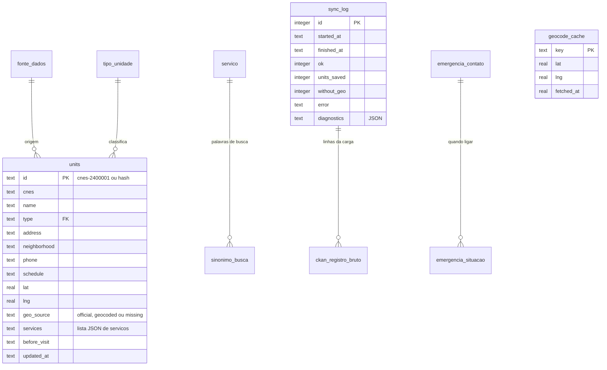

# Modelo de dados — VemSUS (SQLite)

[← Voltar ao README do banco](README.md)

Arquivo: [`database/vemsus_schema_sqlite.sql`](vemsus_schema_sqlite.sql). Versão SQLite do modelo v2, compatível com o backend ([`backend/app/db.py`](../backend/app/db.py)).

As tabelas `units`, `geocode_cache` e `sync_log` são as usadas pelo backend. A relação entre unidade e serviço fica na lista JSON `units.services`, e a view `v_unidade_servico` a desdobra em linhas.

## De onde vem cada coluna (dataset CKAN → banco)

| CKAN | Banco (`units`) | Regra |
|---|---|---|
| `cnes` | `cnes`, `id` | Agrupa as linhas (uma por serviço) em uma unidade; sem CNES usa hash de nome+endereço |
| `nome_oficial` | `name` | |
| `tipo_unidade` (+ nome) | `type` | Regex com palavra inteira; "Academia da Cidade" é descartada |
| `tipo_servico`, `especialidade` | `services` | Palavras-chave → 18 tags. Sem tag padrão; só o serviço inerente ao tipo (USF/UBS → Atenção Básica, UPA → Urgência, CAPS → Saúde Mental) |
| `endereço` | `address` | Vazio → "Informação não disponível na base oficial." |
| `bairro` | `neighborhood` | |
| `fone`, `horario`, `como_usar` | `phone`, `schedule`, `before_visit` | Horários distintos unidos por " · " |
| `latitude`, `longitude` | `lat`, `lng`, `geo_source` | Vírgula decimal, sinal perdido e inversão corrigidos; fora do Recife → Nominatim → senão `missing` |

## Garantias que o banco impõe

* Coordenada fora do Recife é rejeitada (`CHECK` em `lat` e `lng`).
* `geo_source = 'missing'` ⇔ sem coordenada: nunca existe posição "inventada".
* `services` só aceita lista JSON válida.
* O script é idempotente e as tabelas do backend mantêm as mesmas colunas, na mesma ordem.

## Observações

* A busca com ranking e a distância ficam em [`backend/app/search.py`](../backend/app/search.py). O SQLite não tem `unaccent` nem funções de usuário em SQL.
* As tabelas de conteúdo (`emergencia_*`, `pagina_institucional`, `texto_interface`), `ckan_registro_bruto` e `evento_busca` estão no modelo, mas o backend atual ainda não as lê nem grava.
